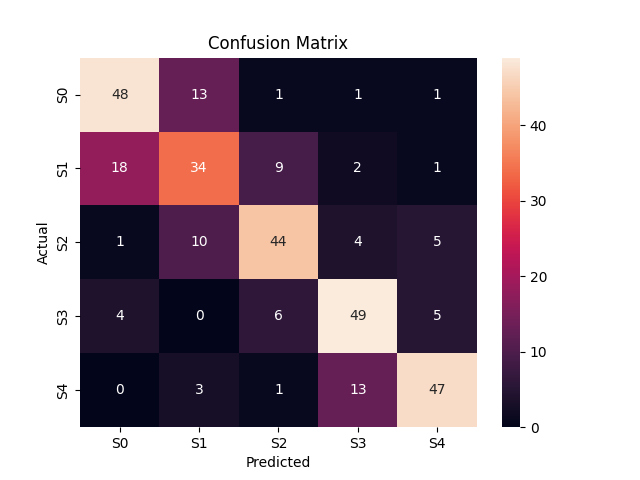

# Fibrosis Severity Classification from scRNA-seq Data

A PyTorch MLP classifier that predicts NAFLD fibrosis severity (stages S0–S4) from single-cell RNA sequencing data. Built as an introduction to PyTorch and PyTorch Lightning using a biologically relevant dataset.

## Dataset

**GSE104782** — single-cell RNA-seq of liver cells from patients with varying degrees of fibrosis. Available from [NCBI GEO](https://www.ncbi.nlm.nih.gov/geo/query/acc.cgi?acc=GSE104782).

- ~1600 cells across 5 severity stages (S0–S4)
- ~20,000 genes per cell
- Labels embedded in cell names (e.g. `OA1_S2.15` → stage S2)

Download the following files and place them in `data/raw/`:
- `GSE104782_allcells_UMI_count.txt.gz`
- `GSE104782_Table_Cell_quality_information_and_clustering_information.xlsx`

## Model

A simple 3-layer MLP:

```
Input (1000 genes) → Linear(128) → ReLU → Dropout(0.5)
                   → Linear(32)  → ReLU → Dropout(0.5)
                   → Output(5 classes)
```

Input dimensionality is reduced from ~20,000 genes to the top 1000 most variable genes. Raw UMI counts are log-normalized and standardized before training.

## Results

**Validation accuracy: 69.4%** (chance = 20% across 5 classes)



Errors are concentrated between adjacent severity stages (e.g. S1↔S0, S4↔S3), suggesting the model learned the ordinal structure of fibrosis progression without being explicitly told stages are ordered. No cell is misclassified to a stage more than one step away with any frequency.

| Stage | Precision | Recall | F1 |
|-------|-----------|--------|----|
| S0    | 0.73      | 0.75   | 0.74 |
| S1    | 0.57      | 0.53   | 0.55 |
| S2    | 0.72      | 0.69   | 0.70 |
| S3    | 0.71      | 0.77   | 0.74 |
| S4    | 0.80      | 0.73   | 0.76 |

## Setup

```bash
git clone https://github.com/yourusername/OA-scRNA-severity-nn.git
cd OA-scRNA-severity-nn

python -m venv venv
venv\Scripts\activate        # Windows
source venv/bin/activate     # Mac/Linux

pip install -r requirements.txt
```

## Usage

### 1. Preprocess

Run the EDA and preprocessing notebook top to bottom:

```
notebooks/01_eda.ipynb
```

This saves processed arrays to `data/processed/`.

### 2. Train

```bash
python main.py
```

Trains for 10 epochs, saves checkpoint to `lightning_logs/`.

### 3. Evaluate

```bash
python src/evaluate.py
```

Loads the latest checkpoint, prints per-class F1, saves confusion matrix to `results/figures/`.

## Project Structure

```
oa-scRNA-severity-nn/
├── main.py                  # entry point — runs training
├── requirements.txt
├── data/
│   └── raw/                 # place GSE104782 files here (gitignored)
├── notebooks/
│   └── 01_eda.ipynb         # EDA and preprocessing
├── src/
│   ├── dataset.py           # PyTorch Dataset class
│   ├── model.py             # MLP architecture
│   ├── train.py             # PyTorch Lightning module
│   └── evaluate.py          # metrics and confusion matrix
├── configs/
│   └── config.yaml          # hyperparameters
└── results/
    └── figures/             # confusion matrix, loss curves
```

## Key Design Decisions

**Log normalization** — raw UMI counts are zero-inflated and right-skewed. `log1p` compresses the dynamic range so highly expressed genes don't dominate training.

**Variance-based feature selection** — retained the top 1000 most variable genes out of ~20,000. Genes with near-zero variance carry no discriminative signal and add noise.

**Architecture sizing** — initial model (2.6M parameters) overfit heavily on 1280 training samples. Reduced to ~644K parameters with higher dropout (0.5) to close the train/val loss gap.

**Stratified split** — ensures proportional representation of all 5 severity stages in both train and test sets.

## Stack

- [PyTorch](https://pytorch.org/) — model definition and training
- [PyTorch Lightning](https://lightning.ai/) — training loop abstraction
- [scanpy](https://scanpy.readthedocs.io/) / [NumPy](https://numpy.org/) / [Pandas](https://pandas.pydata.org/) — data handling
- [scikit-learn](https://scikit-learn.org/) — preprocessing and evaluation metrics
- [Matplotlib](https://matplotlib.org/) / [Seaborn](https://seaborn.pydata.org/) — visualization